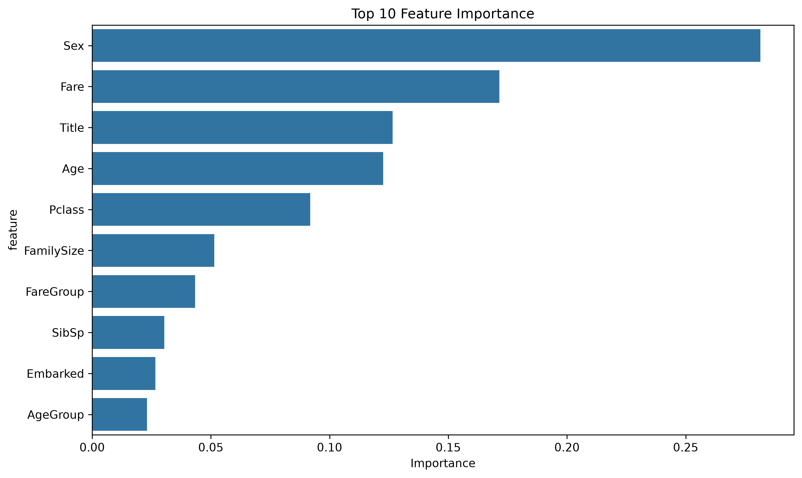

# Titanic Survival Prediction API

A machine learning API that predicts passenger survival on the Titanic using a Random Forest classifier, packaged in Docker and published on Docker Hub so anyone can run it with a single command.

## Project Overview

**Business Context:** Taking a trained model off my own computer and turning it into a service that other people and applications can actually use.

In this project I trained a machine learning model from scratch, containerized it, and published it to Docker Hub. The model is trained inside a Jupyter Docker container, then served from a separate, lighter Docker container using FastAPI. Anyone with Docker can pull the image and get survival predictions for a Titanic passenger through a simple API.

**Docker Hub:** [vfoster2docker/titanic-survival-api](https://hub.docker.com/r/vfoster2docker/titanic-survival-api)

## What This Demonstrates

### Learning Challenge
- Docker was completely new to me: images, containers, Dockerfiles, volumes, and port mapping
- Keeping a training environment and a serving environment separate
- Building the project with current versions instead of the 2023 versions in the course instructions

### Problem-Solving Process
1. **Training Container**: Built a custom Jupyter image with my ML libraries and mounted my project folder into it
2. **Model Training**: Cleaned the data, created new features, and trained a Random Forest classifier
3. **Serving Container**: Wrapped the saved model in a FastAPI app and packaged it into a slim Python image
4. **Testing and Sharing**: Tested the API locally, then tagged it and pushed it to Docker Hub
5. **Debugging**: Found and fixed several things in the instructions that broke on newer versions, like missing values that silently stopped getting filled in with pandas 3

### Professional Outcome
- A complete ML deployment pipeline, from raw CSV to a public Docker image
- An API that checks its input and gives a clear error for bad values instead of a wrong prediction
- Updated the whole project from the 2023 course versions to current versions and fixed what broke

### Tools Utilized
- VS Code with Claude Code for development
- Docker and Docker Hub for containers
- Jupyter Lab (running inside Docker) for training
- Git/GitHub for version control

## Quick Start

### Run the API locally

```bash
docker pull vfoster2docker/titanic-survival-api:latest
docker run -p 8000:8000 vfoster2docker/titanic-survival-api:latest
```

### Use the API

Visit http://localhost:8000/docs for interactive documentation.

#### Example prediction:

```bash
curl -X POST "http://localhost:8000/predict" \
     -H "Content-Type: application/json" \
     -d '{
       "Pclass": 1,
       "Sex": "female",
       "Age": 30.0,
       "SibSp": 0,
       "Parch": 0,
       "Fare": 50.0,
       "Embarked": "S"
     }'
```

#### Response:

```json
{
  "survived": 1,
  "survival_probability": 0.92,
  "prediction_confidence": "High",
  "passenger_profile": {
    "class": "Class 1",
    "gender": "female",
    "age_group": "Adult",
    "family_size": 1,
    "traveling_alone": true,
    "fare_level": "High",
    "embarkation_port": "Southampton"
  }
}
```

## API Endpoints

-  GET /               - Health check
-  POST /predict       - Single passenger prediction
-  POST /predict-batch - Multiple passenger predictions
-  GET /model-info     - Model metadata

## Input Parameters

| Parameter | Type  |       Description            |  Example |
|-----------|-------|------------------------------|----------|
| Pclass    |  int  | Passenger class (1, 2, 3)    | 1        |
| Sex       |  str  | Gender ('male', 'female')    | 'female' |
| Age       | float | Age in years (0 to 100)      | 30.0     |
| SibSp     |  int  | Siblings/spouses aboard      | 0        |
| Parch     |  int  | Parents/children aboard      | 0        |
| Fare      | float | Ticket fare                  | 50.0     |
| Embarked  |  str  | Port ('S', 'C', 'Q')         | 'S'      |

The API checks these values before predicting. For example, `"Sex": "Male"` (capital M) or `"Pclass": 4` gets a clear error back instead of a wrong prediction.

## Model Performance

- **Algorithm:** Random Forest Classifier (100 trees, max depth 10)
- **Accuracy:** about 82% (0.8156) on the test split (179 passengers held out from 891)
- **Features:** Passenger class, sex, age, family size, fare, embarkation port, plus title, age group, and fare group made from those



The full training run, with all the output and charts, is in [`training/train_model.ipynb`](training/train_model.ipynb). You can also open `index.html` to see it in your browser.

## Dataset

The model is trained on Kaggle's Titanic `train.csv`, saved as `training/data/titanic.csv`:

| Field | Description |
|-------|-------------|
| `Survived` | 0 = did not survive, 1 = survived (what the model predicts) |
| `Pclass` | Ticket class (1st, 2nd, 3rd) |
| `Name` | Passenger name (used to get the title, like Mr or Mrs) |
| `Sex` | male or female |
| `Age` | Age in years |
| `SibSp` | Number of siblings/spouses aboard |
| `Parch` | Number of parents/children aboard |
| `Fare` | Ticket price |
| `Embarked` | Port: C = Cherbourg, Q = Queenstown, S = Southampton |

**Total Records:** 891 passengers

## Technologies Used

- **Python 3.13**
- **Docker** - Containers for training and serving
- **Docker Hub** - Sharing the finished image
- **pandas 3.0** - Data cleaning and feature creation
- **scikit-learn 1.9** - Random Forest model
- **matplotlib / seaborn** - Charts
- **FastAPI** - The prediction API
- **Pydantic** - Input checking
- **Uvicorn** - Web server that runs the API
- **Jupyter Lab** - Training environment (`quay.io/jupyter/base-notebook:python-3.13`)

## Repository Structure

```
ml-model-api-project/
│
├── README.md
├── index.html
├── training/
│   ├── Dockerfile
│   ├── requirements.txt
│   ├── train_model.py
│   ├── train_model.ipynb
│   ├── data/
│   │   └── titanic.csv
│   └── models/
└── serving/
    ├── Dockerfile
    ├── .dockerignore
    ├── requirements.txt
    ├── app.py
    └── models/
```

## How to Run

### Prerequisites
- Docker Desktop (Windows/Mac) or Docker Engine (Linux)

### Installation

1. Clone the repository:
```bash
git clone https://github.com/vfoster-repo/ml-model-api-project.git
cd ml-model-api-project
```

### Train the Model

2. Build and start the training container:
```bash
cd training
docker build -t titanic-training .
docker run --name titanic-trainer -p 8888:8888 -v "$(pwd):/home/jovyan/work" titanic-training
```

3. Either open the Jupyter Lab link from the terminal and run `train_model.ipynb`, or run the script from a second terminal:
```bash
docker exec titanic-trainer python train_model.py
```

4. Copy the model files to the serving folder (from the project root):
```bash
cd ..
cp training/models/* serving/models/
```

### Build and Run the API

5. Build and start the serving container:
```bash
cd serving
docker build -t titanic-survival-api .
docker run --name titanic-api -p 8000:8000 titanic-survival-api
```

6. Visit http://localhost:8000/docs to try it out.

### Local Development (without Docker)

Needs Python 3.13 (the same version the model was trained with).

```bash
cd serving
pip install -r requirements.txt
python app.py
```

## Skills Demonstrated

- Writing Dockerfiles for training and serving environments
- Docker volumes, port mapping, and container management
- Data cleaning and feature engineering
- Training and evaluating a classification model
- Saving and loading models with joblib
- Building a REST API with FastAPI and Pydantic
- Publishing images to Docker Hub with version tags
- Debugging version problems and documenting changes

## License

This project was completed as part of the TripleTen AI/ML Engineering program.

## Author

**Victor Foster**
- GitHub: [@vfoster-repo](https://github.com/vfoster-repo)
- LinkedIn: [Victor Foster](https://linkedin.com/in/vfoster-connect)
- Email: victorfoster@hotmail.com

## Acknowledgments

- TripleTen AI/ML Engineering Program Sprint 11 "Project: Docker and Containerization"
- Titanic dataset from Kaggle's [Titanic - Machine Learning from Disaster](https://www.kaggle.com/competitions/titanic) competition

---

If you found this project helpful, please consider giving it a star!
